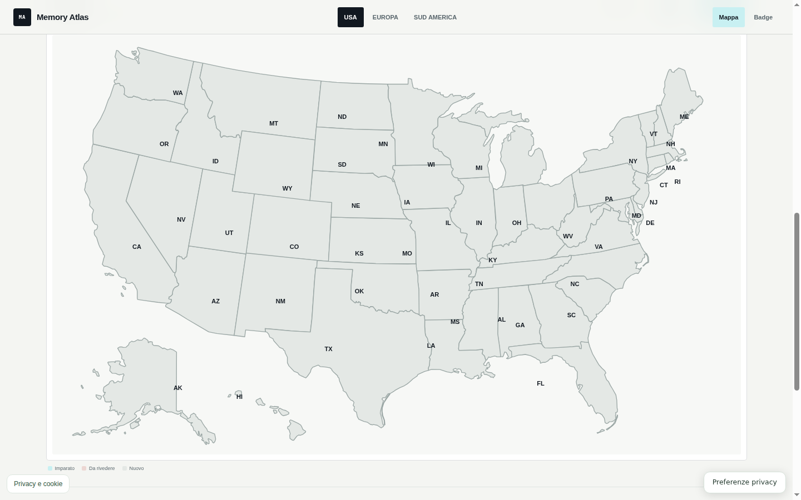
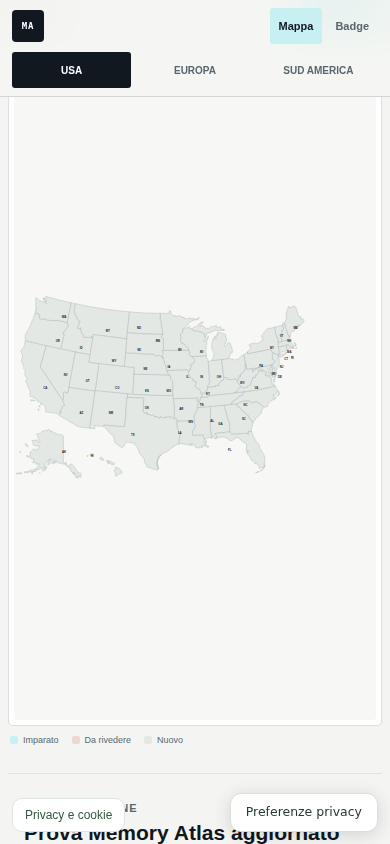
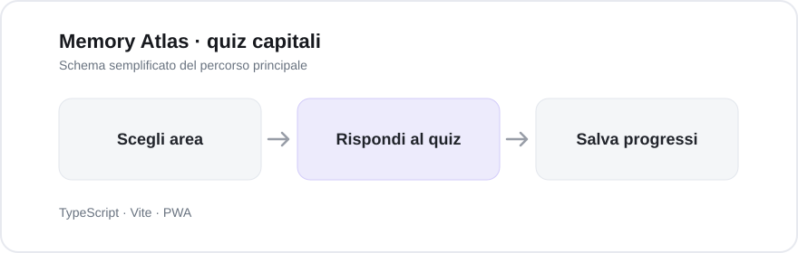

# Memory Atlas · quiz capitali

Un quiz per esercitarsi sulle capitali degli Stati Uniti, dell’Europa e del Sud America. Ho voluto mantenere i progressi sul dispositivo, con la possibilità di esportarli e importarli.

**Apri il progetto:** https://riccardobuzzolan.github.io/imparacapitalistati/

## Screenshot del sito

Screenshot mobile

## Come funziona

Il progetto separa dati geografici, sessione di gioco e interfaccia. Dopo un primo caricamento completo, le risorse locali permettono di usare l'app anche offline.

## Tecnologie e struttura

Per eseguirlo: `npm ci`, `npm run dev`. Per i controlli: `npm run check`.

Le informazioni su distribuzione, accessibilità, gestione dati e ripristino sono conservate nella [documentazione tecnica](docs/TECHNICAL.md).
